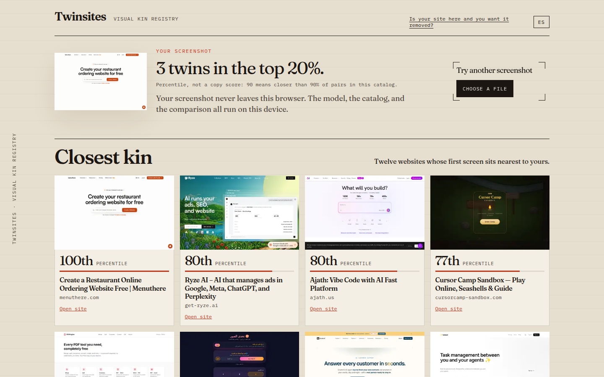

# Twinsites

Every AI landing page has a twin. Twinsites shows you which ones.

Drop a screenshot of a homepage. In the browser, a small vision model lines it up against a field guide of vibe-coded websites and answers four things:

1. The dozen sites that look most like yours, as a percentile of catalog pairs, with a link to the original.
2. Where your page lands on a map of the whole catalog.
3. The marks you share with those twins, and three plain ways to step aside.
4. A PNG card: “My site has N twins in the top 20% of vibe-coded pairs.”

Slop detectors hand out a score. Twinsites names the relatives.



## Privacy

Your screenshot never leaves the browser. There is no account, no upload, and no API key. The model, the thumbnails, and the embeddings are files on this site. Comparison is a cosine similarity on your device.

The page is served with `Cross-Origin-Opener-Policy: same-origin` and `Cross-Origin-Embedder-Policy: require-corp`. The quantized vision graph is not stable with a threaded runtime, so comparison always uses one thread. That also keeps it working when the document is not cross-origin isolated.

## How it works

The offline pipeline in `scripts/` reads the public URL list, screenshots the visible 1440×900 area, and writes the static files under `public/data/`:

- `catalog.json` — titles, URLs, traits, 2D positions, zone labels
- `embeddings.bin` — one normalized vector per site
- `calibration.json` — the percentile curve of catalog pairs
- `thumbs/` — small WebP miniatures

Vectors come from the quantized MobileCLIP-S0 vision encoder (`Xenova/mobileclip_s0`, 8-bit), the same file the page loads from `/models`. They are computed in headless Chrome against a local build, because the Node ONNX runtime does not match the browser vectors. A shown percentile is how many random pairs in the catalog that cosine beats, not a pixel match. A twin is a page in the top 20% of those pairs. The map is a UMAP of those vectors after a PCA reduction. A new screenshot is not run through UMAP; it is placed among its nearest neighbors, which is what “landing in the neighborhood” means. Zone names are the traits that lift above the catalog average, phrased as places.


## Catalog

Homepages are drawn from [awesome-vibe-coded-apps](https://github.com/JefferyLee/awesome-vibe-coded-apps) (CC0 1.0). The legal code is in `public/data/CATALOG-CC0.txt`. Attribution and what we store is in `public/data/ATTRIBUTION.md`.

The committed field guide holds **2,003** sites. Model, runtime, and catalog together are about **53 MB**.

If your site is in the drawer and you want it gone, use the link in the header. It opens a prefilled removal issue.

## Develop

```bash
npm ci
npm run dev
```

`npm run build` writes `dist/`. `npm run preview` serves that build with the same isolation headers as dev.

## Regenerate or extend the dataset

You need Chrome or Chromium on the machine (`CHROME_PATH` overrides `/usr/bin/google-chrome`). The capture step resumes; delete `data/raw` to start clean. That directory is gitignored. Embedding reads `dist/`, so the dataset command builds the site before it encodes screenshots.

```bash
# optional: curl the catalog JSON yourself and pass --catalog
npm run dataset -- --attempts 4000 --success 2000 --concurrency 4
```

Or run the stages separately:

```bash
npm run dataset:capture -- --attempts 4000 --success 2000
npm run dataset:embed
npm run dataset:project
```

`npm run dataset:calibrate` rewrites the zone names and the percentile curve from the files already in `public/data`, without recapturing.

Keep thumbnails small. The projection step re-encodes them to 420px WebP. Prefer that over Git LFS.

## Deploy

`.github/workflows/deploy.yml` runs on every push to `main`: `npm ci && npm run build`, then `rsync` of `dist/` to the web root. The workflow expects an ed25519 key in the `VPS_SSH_KEY` secret. The server already speaks HTTP with SPA fallback, long-lived caching for `/assets/`, and the COOP/COEP/CORP headers.

## Next

The suggestions are rules read off shared marks. A later version can go further: one concrete move per trait (type, image, grid, motion), and a redesign prompt you can paste into Cursor or v0.

## License

MIT. Copyright Ana Gui. See [LICENSE](LICENSE).

The vision weights keep their own notice in `public/models/Xenova/mobileclip_s0/LICENSE`. The WebAssembly runtime notice is in `public/ort/NOTICE.md`.
