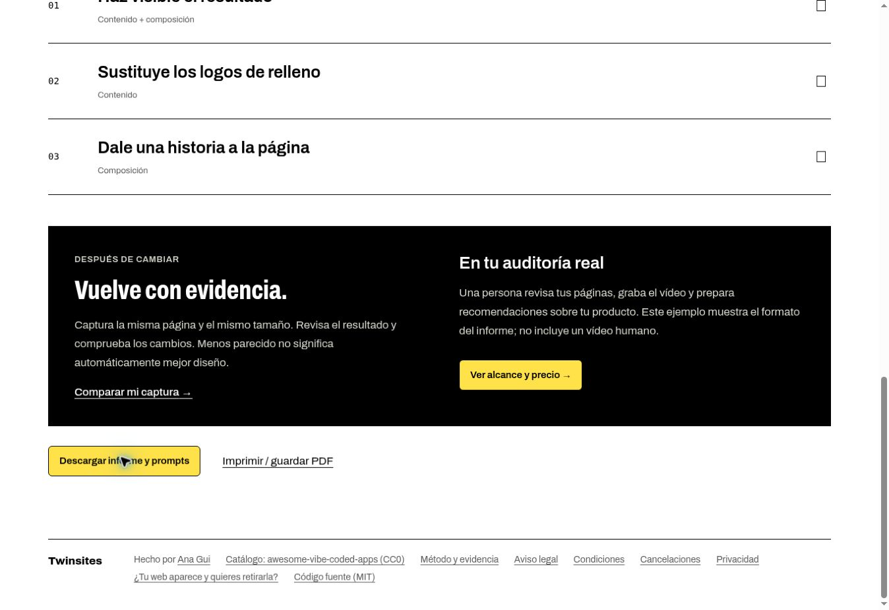

# Twinsites Studio

Find visual relatives, understand the evidence, and give your homepage its own direction.

Twinsites combines a free on-device screenshot comparison against 2,003 catalog pages with an explainable editorial checklist, editable action plans and an optional human audit service. Similarity is not a design-quality score or proof of AI authorship.

**Current state:** implementation candidate, not deployed. [Release evidence and remaining launch work](docs/release-candidate.md).



## Explore the product

- `/`: screenshot analysis, catalog search, twins, checklist and downloadable plan.
- `/sample-audit`: fictional annotated report with original/proposed views, three priorities, prompts and export.
- `/method`: actual model recipe, 60 AI-labeled pairs and evaluation limits.
- `/report`, `/zones`, `/site/<slug>`: catalog statistics and visual exploration.
- `/services`: scope, availability and optional human audit. Booking remains closed until seller and provider configuration is complete.
- `/legal`, `/terms`, `/withdrawal`, `/privacy`: operator-dependent legal information; not legal approval.

## Model and privacy

MobileCLIP-S0 FP16 runs in the browser with one WASM thread. Two overlapping square crops preserve both horizontal ends; their normalized embeddings are averaged and normalized. All catalog vectors, map and calibration were rebuilt from the committed 420px desktop thumbnails. Original full-resolution captures were unavailable. History and catalog enforce a matching recipe version.

The 60 visual pair labels were produced by an AI assistant, not independent humans. The held-out set is small and curated; it does not certify accuracy. Inspect the evidence at `/method` and `quality/`.

Uploaded screenshots stay in the browser. Optional pasted-URL capture uses a separately configured worker. Human orders send the email, URLs and brief explicitly submitted. Analytics is disabled unless configured; editor context and evidence notes are not analytics event properties. Local before/after history can be cleared by the user. Download your editable action plan before navigating away.

## Develop

Node 20+:

```
npm ci
npm run dev
npm run test:product
npm run test:worker
npm run typecheck:worker
npm run build
```

Install worker dependencies separately in `worker/` when running its tooling. `npm run preview` serves the built app with production security headers. The original full browser suite is `npm run qa`; see the release record for what was actually executed.

`npm run model:lab` enables the local-only encoding workbench. Ordinary development and production do not enable its artifact-writing endpoint. `npm run model:evaluate` regenerates evaluation from committed labels and vectors. See the release record before attempting the one-time q8 migration helper.

## Operations and sources

- [Studio setup and operations](docs/studio.md)
- [Worker setup](worker/README.md)
- [Competitor review](docs/anti-web-slop-review.md)
- [Release candidate and reproducibility](docs/release-candidate.md)

Catalog source: [awesome-vibe-coded-apps](https://github.com/JefferyLee/awesome-vibe-coded-apps), CC0. Code: [MIT](LICENSE). Public creator: Ana Gui. Contracting seller details must be configured before commerce is activated.
