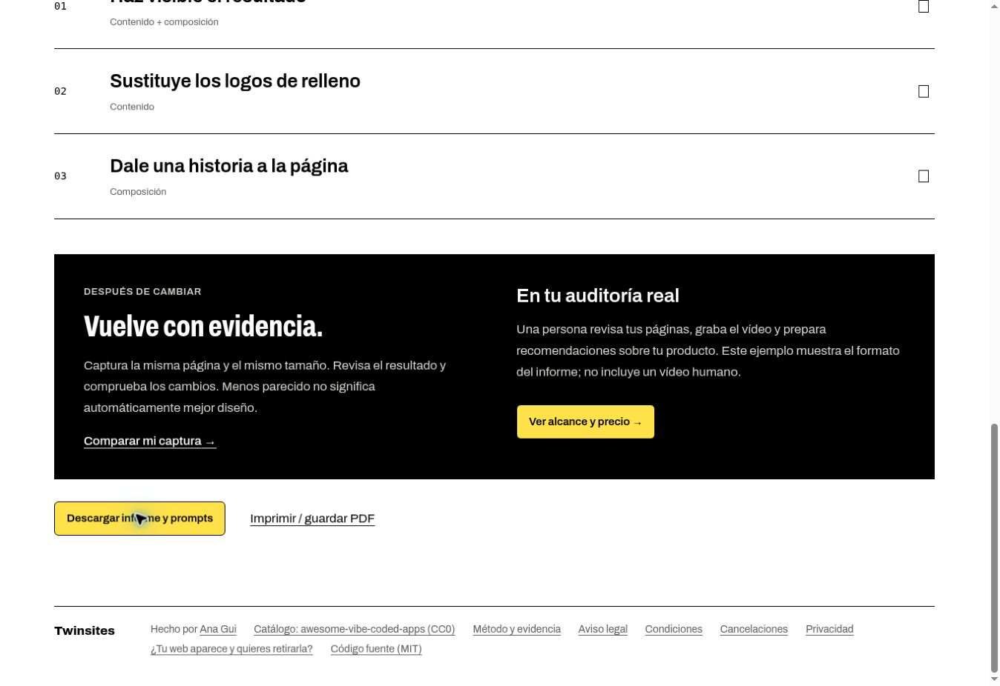

# Twinsites Studio — release candidate

Prepared 7 November 2026, stacked on PR #18. Implemented and tested locally; not merged or deployed. This is a technical candidate, not independent model certification or an activated business.

## The product

The free browser check leads to an editable action plan: product context, up to three priorities, evidence, progress and Markdown for the user's editor. Similarity remains separate from editorial quality. Completion marks do not certify an improvement.

`/sample-audit` is an ES/EN editorial report with three annotated observations, original/proposed views, acceptance criteria, prompts, Markdown export and print styling. Acme Notes is explicitly fictional, with no claimed customer outcome or human video. `/method` exposes all 60 labeled pairs and the actual evaluation, including failures.

The existing Studio flow from PR #18 offers a human audit (€89 first page, €29 each additional page, maximum three), two slots per week and a 30-day follow-up. The console now records actual useful-change counts instead of a hardcoded three, and shows pending, overdue and follow-up counts from orders. Dates use Europe/Madrid. Seller configuration and real provider verification still gate booking. See [Studio operations](studio.md).

## Model work actually completed

- Build preparation downloads the FP16 graph from the pinned revision and verifies SHA-256 before tests/build; visitors still load it from the site itself. No unverified model is published.
- FP16 vision graph: 22,876,479 bytes; pinned Hugging Face revision `757d59c9c6870a76a4b0306f05f5061bca15c39f`. Hash in `quality/model-encoding.json`.
- Left and right overlapping square crops; normalize each embedding, average and normalize again. One WASM thread.
- All 2,003 catalog entries re-encoded in four browser shards. **Inputs were committed 420px desktop thumbnails**, because original full-resolution captures were not available.
- PCA/UMAP map, clusters, 400,000 seeded calibration pairs, nearest-neighbor data and public catalog report regenerated. Stored vectors match the browser recipe. The retired q8 graph is removed.
- Before/after history from a different model recipe is rejected. Catalog recipe is checked on load.
- 27 embeddings: three images, three repetitions, three cloud-browser sessions. Minimum normalized cosine 1 and maximum absolute component difference 0. This is a narrow determinism check, not cross-browser, device or mobile performance validation.
- Zone names no longer rely on unreliable density, gradient or bento classifications.

## The 60 pairs: useful evidence, limited claims

`quality/pairs/labels-ai.json` contains 60 unique visual pairs with AI labels and individual Spanish reasons. The assistant implementing the change also labeled them. They are **AI annotations, not independent human labels**. Original seeded selection is retained separately; visual curation selected some stronger matches before the candidate scores were inspected. This is not a random prevalence sample.

Development and test contain 30 pairs each, with no shared websites across those splits. Within a split, a site may appear more than once. Thresholds maximize development balanced accuracy only; the corrected test is evaluated after duplicate review. P16 and P34 were restored from `selection.json` because visual curation had duplicated P11 and P42. Replacement labels were assigned by visual inspection before computing their scores, but the original evaluation was already known: this is not a new untouched holdout. The q8 baseline was recalculated for the exact revised pair identities from commit `355c147e54d1ec288a125d18bb5494c2032bc675`, with its original binary SHA checked.

| Corrected exploratory test (30 pairs) | q8 / center | fp16 / two crops |
|---|---:|---:|
| Strong matches found | 2 / 4 | 2 / 4 |
| Other pairs falsely called strong | 15 / 26 | 1 / 26 |

The candidate makes fewer false-positive calls on this small curated set, but still misses half the four strong matches. Do not advertise these fractions as production accuracy. The binary threshold evaluation does not validate every UI percentile band. `releaseReady=false`, `humanLabelsVerified=false` remain intentional.

## Verification performed

- Production build and frontend typecheck passed.
- Product tests: 10/10; worker tests: 44/44, with mocked commercial providers.
- Worker typecheck passed. Wrangler deployment dry-run was blocked by automatic approval review because it may communicate the bundle/authentication metadata to Cloudflare; it was not verified and no deployment is claimed.
- Browser: actual screenshot upload completed inference and displayed the diagnosis/action plan. Report annotations and original/proposed toggle inspected. Markdown report download completed. Method page displayed the real evaluation and pairs.
- Responsive report and method at 390px simulated viewport (375px content width including scrollbar): no horizontal document overflow. Not a physical iPhone/Safari test.
- Browser computation evidence is in `quality/model-encoding.json` and `quality/model-stability.json`. The graph SHA, vector SHA, dimensions, normalization and recipe agreement are covered by a product test.
- The legacy `npm run qa` browser suite was **not run** in this environment. Its removed mosaic/14-to-0 homepage assertions were updated to the current specimen and fictional comparison; this is not a claim that the full suite passes. Production CSP browser smoke remains pending.



## Reproduce / review

Use Node 20+ and install root and worker dependencies. In environments where the optional ONNX Node installer cannot fetch its GPU libraries, `npm ci --ignore-scripts` suffices for the browser-based workflow used here. This does not establish the old Node encoder's functionality.

```
npm run test:product
npm run test:worker
npm run typecheck:worker
npm run build
npm run model:evaluate
node --import tsx scripts/render-pairs.ts
```

The last command renders the final pair set into ignored contact sheets. Evaluation uses the committed q8 baseline scores and current candidate vectors.

For a full re-encode, run `npm run model:lab`, visit `/model-lab.html?shard=0` through `shard=3`, and activate each catalog run. This developer-only endpoint is opt-in, same-origin and writes fixed filenames under ignored `quality/generated`. Stability runs save separate observations. The helper `model:finalize` is a **one-time migration from the q8 base**: it explicitly refuses to overwrite baseline provenance on an already-FP16 checkout. Review it before replaying from PR #18. Then project with `npm run dataset:project -- --existing-thumbs`, regenerate mosaic/distinct, evaluate and build. Do not silently substitute new captures for this recipe version.

## Launch work still requiring real evidence

1. Independent human adjudication of labels and a larger test, including difficult negatives and mobile/full-resolution cases. Keep indicative comparison messaging until then.
2. Physical mobile and production-browser/CSP smoke, including download size, latency and cancellation behavior.
3. Actual seller identity, tax/contact/address configuration and review of the legal texts for that operator. Ana is the public byline; it cannot substitute for the contracting seller.
4. Real Stripe/email configuration and an authorized provider test of checkout, signed webhook, invoice, cancellation/refund and delivery. No real transaction or email was executed here.
5. Merge/release decision after reviewing this stacked PR and its prerequisites. No production publication is implied by this delivery.
